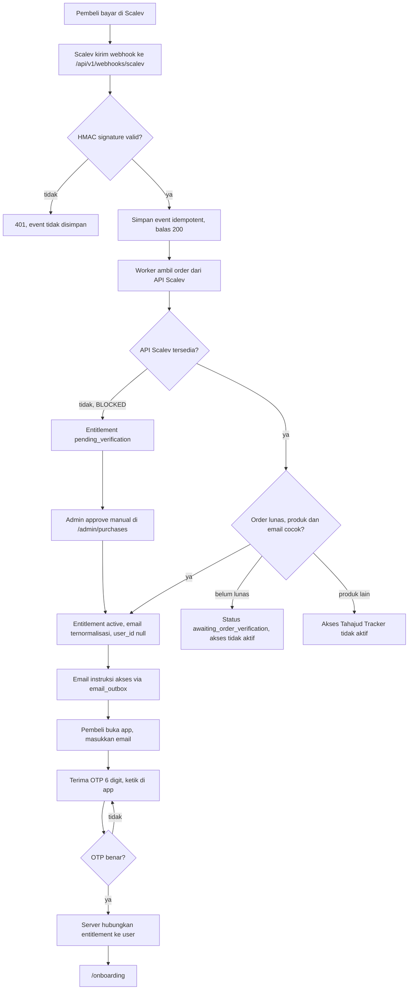
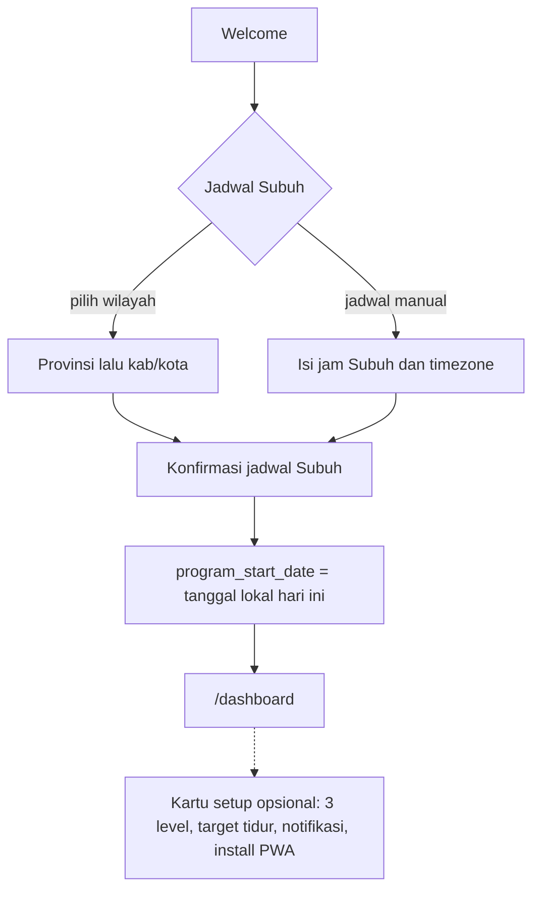
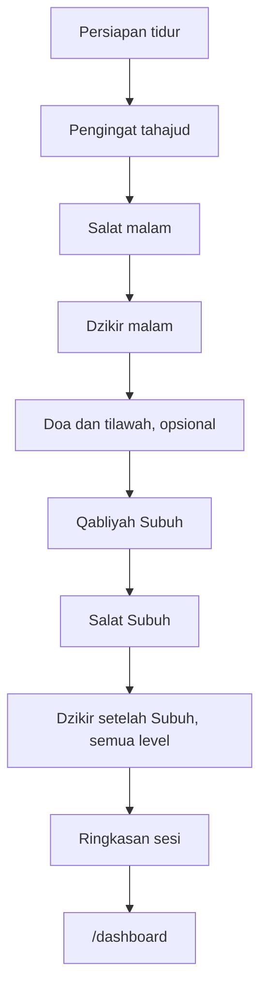
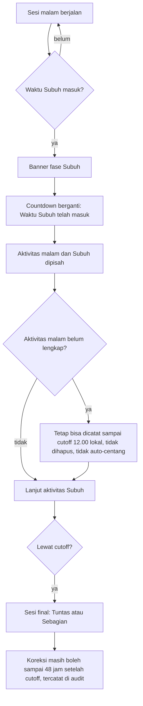

# SITEMAP: Tahajud Tracker

Sumber: `docs/PRD-v1.2.md` §5.2, §5.3, §6, §11.4. Kolom "Sesi" = sesi yang membangun layar itu. "Ada" = route sudah ada di repo (S1).

## Navigasi utama (PRD §5.1)
Bottom nav di mobile dan tablet, sidebar di desktop (>= 1024px). Laporan lengkap dibuka dari dashboard, bukan dari nav.

| Tab | Route | Ada |
|-----|-------|-----|
| Beranda | `/dashboard` | placeholder |
| Amalan | `/worship` | placeholder |
| Al-Qur'an | `/quran` | placeholder |
| Profil | `/profile` | placeholder + pengaturan tema |

## Route pengguna (PRD §5.2)
| Route | Halaman | Sesi | Ada |
|-------|---------|------|-----|
| `/` | Halaman masuk ringan: info singkat, tombol Masuk, link beli ke Scalev. Sudah login diarahkan ke `/dashboard` | S1, S4 | ya (tanpa redirect, belum ada auth) |
| `/login` | Input email | S4 | belum |
| `/auth/verify` | Input OTP 6 digit; konfirmasi magic link (tombol, bukan auto) | S4 | belum |
| `/access-status` | Purchase pending, no active access, session expired | S4 | belum (state UI ada di gallery) |
| `/onboarding` | Onboarding | S4 | belum |
| `/levels` | Perjalanan level | S3 | belum |
| `/worship/session` | Sesi aktif | S3 | belum |
| `/worship/dhikr/[id]` | Counter dzikir | S3 | belum |
| `/quran/[surah]` | Reader surah | S4, S7 | belum |
| `/reports` | Laporan detail | S4 | belum |
| `/reports/calendar` | Riwayat istiqomah | S4 | belum |
| `/notifications` | Pusat notifikasi | S4 | belum |
| `/settings` | Tema, font, durasi, notifikasi, jadwal manual | S4 | belum (tema ada di `/profile`) |
| `/settings/devices` | Perangkat aktif | S4 | belum |
| `/settings/account` | Hapus akun, unduh data | S4 | belum |
| `/help` | Bantuan, referensi, kontak CS WhatsApp | S4 | belum |

Route bantu, bukan bagian PRD:
| Route | Fungsi |
|-------|--------|
| `/dev/components` | Galeri komponen. 404 di production kecuali `NEXT_PUBLIC_ENABLE_DEV_ROUTES=true` |
| `/manifest.webmanifest` | Manifest PWA |

## Route admin (PRD §5.3)
Semua butuh autentikasi, MFA, dan role yang dicek di server. Dibangun di S8.

| Route | Fungsi |
|-------|--------|
| `/admin` | Ringkasan |
| `/admin/users` | Pengguna |
| `/admin/purchases` | Pembelian, approve manual untuk `pending_verification` |
| `/admin/entitlements` | Akses, pindah email dengan alasan dan audit |
| `/admin/levels` | Konfigurasi level |
| `/admin/activities` | Aktivitas |
| `/admin/dhikr` | Konten dzikir |
| `/admin/quran-content` | Konten Al-Qur'an |
| `/admin/notifications` | Notifikasi |
| `/admin/prayer-times` | Jadwal salat |
| `/admin/jobs` | Job terjadwal |
| `/admin/audit-logs` | Audit log |

Admin tidak boleh melihat data berhalangan (excused) per pengguna (CLAUDE.md).

## Flow 1: pembelian sampai aktivasi (PRD §6.1)

## Flow 2: onboarding jalur minimum (PRD §6.2)
Langkah opsional bisa dilewati dan muncul lagi sebagai kartu di dashboard.

## Flow 3: alur ibadah harian (PRD §6.3)

## Flow 4: transisi Subuh (PRD §11.4)

Cutoff 12.00 dan jendela 48 jam berstatus PROVISIONAL (PRD §11.2).
